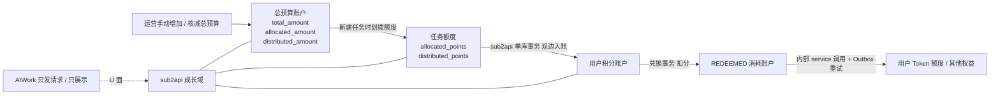
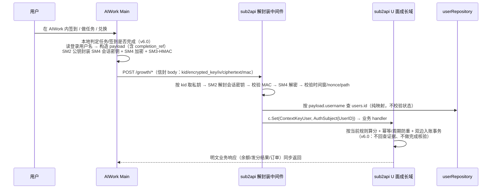

# AIWork 用户成长计划｜优化设计 v6.2（内部系统·国密 SM2 加密报文互信·完成判定在 AIWork·总预算制）

> 基线：《AIWork 用户成长计划：后端与 GoldenDB 数据设计》v1
> 日期：2026-11-17 ｜ 代码基线：`bxSub2Api`（Go + Gin + Ent + MySQL 8 / GoldenDB 兼容模式）
> 配套契约：[GROWTH_PLAN_AIWORK_API.md](GROWTH_PLAN_AIWORK_API.md) **v4.0（冻结，AIWork 唯一对接依据）**
>
> **v6.0 → v6.1（预算模型变更，非破坏性）**：取消「TASK / CHECKIN / REDEEM 多积分池」，改为**单一总预算 + 任务额度分配**——
> 总预算由运营手动增加/核减；**新建任务时从总预算划拨一份额度给该任务**，发放只消耗任务额度；任务额度耗尽即停止发分，可追加或回收。
> 兑换不再占用发放预算（兑换消耗的是用户已获得的积分），`REDEEMED` 仅作为消耗账户与统计口径。
> U 面 11 个接口、SM2 信封、完成判定归属、响应字段**全部不变**（对外无感）。
>
> **v6.1 → v6.2（任务生命周期澄清，非破坏性）**：**任务不提供删除**——M 面不注册 `DELETE`、`growth_tasks` 不加 `deleted_at`；移除手段只有下线，下线后可「重新上线」（须重新划拨额度）。`task_code` 创建后不可修改、不可复用。U 面与契约**零改动**。

---

## 0. 优化摘要

| # | v1 的问题 | 现行结论 |
|---|---|---|
| 1 | 抽象出「成长计划服务」+「模型平台」两方，AIWork 需经平台中转，且声明「不假定平台已有接口」 | **sub2api 就是成长计划服务**，同时它就是模型网关。全局只有两方：sub2api ↔ AIWork。Token 发放是 sub2api **内部 service 调用**，不是跨系统 HTTP |
| 2 | 「用户级凭证」列为上线阻塞项，但未给出落地路径 | **内部系统不做任何服务间身份校验，不改 AIWork 登录**：请求报文用**国密 SM2 非对称数字信封**加密（sub2api 持私钥、AIWork 持公钥；SM2 封装 SM4 会话密钥 + SM4 加密 + SM3-HMAC），服务端能解封装即可信；报文中带业务用户名，仅映射为 `users.id` 做账务，不验签、不校验账号状态 |
| 3 | 任务完成依赖「可信任务服务 / Orange 事件」，而 sub2api 侧不存在该组件 | **v6.0 定稿：任务/签到是否完成由 AIWork 侧判定**，提交完成请求时带 `completion_ref`；sub2api **不回查 `usage_logs`、不接 I 面事件、不做证据核验**，收到完成请求即按当前规则算分并发放（账务防重仍由服务端负责） |
| 4 | `idempotency_key` 同时用于接口去重与账务防重，语义混淆 | 拆成 **L1 请求幂等**（复用 `idempotency_records`）+ **L2 账务唯一约束**（DB 唯一键），两层都不可省 |
| 5 | 游标分页、REST 路径、`/growth/*` 裸前缀、分布式 ID 等与项目规约不一致 | 对齐 `response.Response` envelope、`/api/v1/*` 前缀、`AUTO_INCREMENT BIGINT`、`sqlArchiving/182_*.sql`、RBAC coverage、`config.yaml` 同步 |
| 6 | API 清单缺「我的订单列表」和「完成请求状态查询」，异步核验无法闭环 | 接口清单随模型演进；**v6.0 完成请求改为同步发分，删除异步核验状态查询接口**，U 面收敛为 **11 个接口**（读 7 / 命令 3 / 状态 1），见配套契约 v4.0 |
| 7 | 后管能力与给 AIWork 的接口混在同一节 | **两平面隔离**（U / M），M 面永不暴露给 AIWork，AIWork 也不得持有管理凭证；v6.0 删除 I 面 |

---

## 1. 职责边界（唯一权威）

### 1.1 一句话定义

- **sub2api = 账务与规则权威**：**总预算与任务额度**、钱包与双边总账、任务与规则版本、商品与版本定价、库存/Token 预算、兑换订单与履约、运营后管、审计与对账。**所有「账事实」只在 sub2api 产生。**
- **AIWork = 用户入口 + 完成判定方**：展示 + 发起请求 + **判定任务/签到是否完成**（本地业务规则）。不计算奖励、不本地改余额、不缓存权威数据。**v6.0 职责反转**：任务是否完成由 AIWork 判定并声明，sub2api 不再核验完成证据，仅按当前生效规则计算应发积分、执行防重并发分。

### 1.2 职责矩阵

| 能力 | sub2api | AIWork |
|---|---|---|
| 用户映射 | **OWN**：SM2 解封装报文后按业务用户名查 `users.id` 做账务关联（纯映射，非身份校验）；写 `AuthSubject` 仅为幂等隔离 | Main 从既有登录态读用户名塞进加密报文；登录功能零改动；Renderer 不接触私钥 |
| 积分余额 / 流水 | **OWN**：事务内维护，流水不可变 | 只渲染响应字段；余额为空则查 `POST /growth/me` |
| 任务目录 / 规则 / 周期 / 上限 | **OWN**：后台配置、版本发布 | 只展示服务端下发的文案、进度、奖励说明 |
| **任务/签到完成判定** | **不判定、不核验**：收到完成请求即视为「已完成」，不做证据回查 | **OWN**：本地/业务侧判定任务或签到动作是否完成，完成后提交完成请求并声明 `completion_ref` |
| 奖励计算 / 积分转账 | **OWN**：按当前生效规则算分、**任务额度 → 钱包**双边入账、周期/上限/额度防重 | 无；禁止乐观加积分，不得指定分数/周期/预算来源 |
| 总预算 / 任务额度 | **OWN**：总预算手动增减、新建任务时划拨额度、追加/回收、额度耗尽拦截 | 无（完全不可见，也不可指定） |
| 商品 / 定价版本 / 库存 / 限购 | **OWN**：按当前有效版本定价 | 只展示服务端价格；`expected_version` 仅用于发现目录过期 |
| 兑换下单 / 扣分 / 履约 / 退款 | **OWN**：事务 + Outbox 重试 | 只提交 `product_id` + 幂等键，展示订单状态 |
| 后管 UI（预算、任务、商品、订单、调账） | **OWN**：sub2api frontend + M 面 | **禁止**提供或调用 |
| 审计 / 对账 / 报表 | **OWN** | 无 |

**边界铁律（v6.0 修订）**：AIWork 判定「任务是否完成」并声明，sub2api 信任该声明、按规则裁决「发多少、归哪个周期、是否超上限」。AIWork 仍**不得本地加分**——只有收到 sub2api 的业务响应，界面才能更新余额与订单状态。「判定完成」和「积分到账」是两个动作，分属两侧。

### 1.3 三平面接口（U / M / W，职责分离的物理体现）

| 平面 | 路径前缀 | 调用方 | 信任方式 | 说明 |
|---|---|---|---|---|
| **U 面**（用户面） | `/api/v1/growth/*` | AIWork Electron **Main**（用户态） | 请求体 SM2 数字信封（SM2 封装 + SM4 加密 + SM3-HMAC）；服务端私钥解封装成功即可信 | **11 个接口**，配套契约 v4.0 全文定义；挂 `GrowthPayloadDecryptor` 解封装并映射 `AuthSubject.UserID`；**无 JWT、无令牌交换、无身份头**；任务完成声明也在此 |
| **M 面**（管理面） | `/api/v1/admin/growth/*` | 仅 sub2api 后管 Vue | `AdminIdentityAuth` + RBAC permission | 总预算/任务额度/任务/商品/订单/调账/报表；**不对 AIWork 开放** |
| **W 面**（Web 用户面） | `/api/v1/user/growth/*` | 登录用户（sub2api 自带前端） | `jwtAuth` 会话 | 只读概览 + 兑换；**不提供签到**（签到只能在 AIWork 发起），见页面设计文档 |

> **v6.0 删除 I 面**（原 `/api/v1/integrations/growth/*`）：任务完成判定归属 AIWork、经 U 面完成请求直接声明，不再有可信事件接入需求。原 `task-events` 接口与 `growth_task_events` 表作废。
>
> **v6.1 新增 W 面**：sub2api 自带前端（管理端与用户端）与服务同源，M/W 面**不使用 SM2**，走既有 `AdminIdentityAuth` / `jwtAuth`；SM2 只解决「AIWork 没有 sub2api 会话」的问题。三面共用同一 `GrowthService` 与账务事务，唯一键空间共享。
>
> AIWork Renderer 只经类型化 `window.aiwork` preload API 发起调用，不直接请求任何平面、不接触密钥；密钥仅 Electron Main 持有。切换账号时 Main 从新登录态读取用户名放入报文，并清除界面用户数据。

### 1.4 资金流（v6.1：单库事务，总预算 → 任务额度 → 钱包）



三条硬不变量（详见 §4.2）：

1. `0 ≤ allocated_amount ≤ total_amount` —— 划拨不能超过未分配余额，核减不能吃掉已划拨部分；
2. 任务发放前必须 `allocated_points - distributed_points ≥ 本次奖励` —— 额度不足即停止发分，绝不透支；
3. 兑换不消耗发放预算 —— `REDEEMED` 是用户钱包的去向，不是预算的支出。

---

## 2. 信任模型（v6.0：内部系统，国密 SM2 加密报文互信 + 完成判定在 AIWork）

> **决策变更（2026-11-17，第三次调整）**：在 v4「共享对称密钥」基础上升级为**国密 SM2 非对称加密**。仍然**不做任何服务间身份校验，不改 AIWork 登录**。原 v2 的 JWT 令牌交换、v3 的 `X-Growth-User` 身份头校验、v4 的共享对称密钥均整体作废。
>
> **v5 → v5.1（密钥管理简化，非破坏性）**：SM2 密钥对改为**直接分配、双方写死固定值**——sub2api 侧生成密钥对，私钥写死服务端、公钥写死 AIWork Main；**取消 `kid` 轮换、取消公钥 SM3 指纹校验、取消 KMS / 配置密文**。信封格式、算法、接口、账务事务均不变。
>
> **v5.1 → v6.0（任务完成判定职责反转，破坏性；配套契约 v4.0）**：任务/签到是否完成由 **AIWork 判定并在 U 面声明**（带 `completion_ref`），sub2api **不再回查 `usage_logs`、不接 I 面事件、不做证据核验**，收到完成请求即视为「已完成」，仅按当前规则算分并发分。I 面整体删除、完成请求状态机改为同步、U 面 12 → 11 个接口。**加密、密钥、账务事务、商品/兑换均不变。**

### 2.1 核心原则：私钥解封装即信任

- **信任根**：SM2 非对称密钥对——**sub2api 持私钥（永不出服务端）**，AIWork 持公钥。AIWork 用公钥封装报文，sub2api 用私钥解封装成功 + SM3-HMAC 校验通过即视为可信调用。**没有令牌、没有身份头、没有账号状态校验。**
- **算法组合**：SM2 封装 SM4 会话密钥 + SM4-CBC 加密 payload + SM3-HMAC 完整性（详见契约 1.3）。纯 SM2 加密明文有长度限制，故用混合信封。
- **用户标识**：报文里带业务用户名（email），服务端解封装后仅做 `GetByEmail → users.id` 的**账务映射**——这不是身份校验，不验签、不查 `IsActive()`、不核对凭证；用户不存在按数据错误返回，不发奖。
- **完成声明（v6.0 新增）**：任务/签到是否完成由 AIWork 判定，完成请求携带 `completion_ref`；sub2api 信任「解封装成功即代表可信调用方」这一前提，**不再独立验证任务是否真的完成**。发分数额、周期、上限仍由 sub2api 规则裁决。
- **账务不变**：所有账表仍用 `users.id`（int64）关联；幂等 `ActorScope` 仍显式构造，避免退化 `user:0`。
- **AIWork 登录零改动**：Main 从既有登录态读用户名塞进加密报文即可，不新增登录步骤、不引入令牌、Renderer 不接触私钥。

### 2.2 密钥归属（v5.1：直接分配、双方写死）

| 密钥 | 持有方 | 要求 |
|---|---|---|
| SM2 私钥 | **仅 sub2api 服务端**（写死常量） | 绝不下发客户端/进日志/进响应；**不轮换、不进 KMS / 配置密文**；变更需双方同步改代码发版 |
| SM2 公钥 | AIWork Main（`crypto.ts` 写死常量）+ sub2api | 由 sub2api 侧生成后直接分配；**不做 SM3 指纹校验、不做运行时下发**；公钥被替换风险由内网边界 + 代码库访问控制承接 |
| SM4 会话密钥 / IV / nonce | 每请求临时生成 | 随机、不复用、不持久化、不进日志（报文级随机量，与写死的长期密钥不同） |

> **一次性分配**：密钥对由 sub2api 侧生成后固化到两个项目，AIWork 只拿公钥、sub2api 只留私钥；上线前必须确认两者配对。写死意味着**无热轮换**——换密钥要双方同步改代码并发版，发版完成前跨版本请求返回 `CRYPTO_KEY_UNWRAP_FAILED`。

> **重要语义**：非对称加密只保证「机密性 + 完整性」，**不保证调用方身份**——公钥可公开，任何拿到公钥者都能构造合法密文。这与「不做服务间身份校验」产品决策一致，是**可信调用方模型**，不是身份认证模型。若将来需要来源认证，需叠加 SM2 签名验签，作为新版本破坏性变更评审。

### 2.3 请求链路



要点：
1. **解封装中间件前置**：`GrowthPayloadDecryptor` 在所有 U 面 handler 之前执行，SM2 解封/MAC/SM4 解密/防重放/`path` 绑定任一失败即早退（`CRYPTO_*` 错误码），不进业务层。**顺序固定**：先 MAC 后解密，防填充/oracle 攻击。
2. **统一 POST**：11 个接口全部 `POST`，业务参数放加密 payload 的 `params`，避免 GET 明文 query 泄露用户名。
3. **会话密钥/IV 每次随机**：重试复用幂等键但**重新生成 SM4 会话密钥 + IV 并重新完整加密**；绝不复用。
4. **必须写 `AuthSubject`**：映射出的 `users.id` 写入 context，否则幂等组件 `ActorScope` 退化为 `user:0`，不同用户幂等键互相踩踏。
5. **SM2 密文编码统一 C1C3C2**：tjfoc/gmsm 与 sm-crypto 都需显式确认，禁止一端 DER 一端裸拼接。
6. **切账号**：Main 从新登录态读新用户名构造报文；服务端无状态，但同一逻辑请求重试的用户名必须与首次一致。

### 2.4 边界前提与风险取舍（必须书面化）

AIWork 侧只持有公钥，消除了“私钥被逆向”风险（相对 v4 的安全提升）。v5.1 密钥写死进一步简化，但**无热轮换能力**——落地前必须满足：

| 前提 | 要求 |
|---|---|
| 密钥保管 | 密钥对由 sub2api 侧生成后直接分配双方写死：私钥仅 sub2api 常量、公钥仅 AIWork Main 常量；私钥不进日志/响应。取消 KMS / 配置密文 / 指纹校验 / `kid` 轮换；变更须双方同步发版。代码库访问受控、构建产物不被篡改是新的边界前提 |
| 网络边界 | U 面仅内网 / VPN 可达，不暴露公网；反向代理按来源 IP 白名单限制 |
| 传输 | 强制 HTTPS；日志只记 `kid`/`request_id`/来源 IP，**不记私钥、会话密钥与明文 payload** |
| 时钟同步 | 双方 NTP 同步，`issued_at` 时间窗（默认 ±5 分钟）才可靠 |
| 数据范围 | U 面只提供映射用户自己的数据，跨用户查询参数一律不接受 |
| M 面隔离 | 后管仍走管理员认证 + RBAC；AIWork 不得调用 |

> 若 U 面要出内网或引入不可信调用方，加密 + 内网边界不再足够（公钥可公开 ⇒ 无法证明来源），必须重新评审用户级认证 + SM2 签名方案。

### 2.5 不变式

- 服务端信任边界 = 私钥持有 + 报文机密性/完整性；业务用户名只做 `users.id` 映射，不做身份裁决。
- 报文/请求体出现 `user_id` / `points` / `awarded_points` / `token_amount` / `pool_code` / `rule_version` / `business_date` / `cycle_key` 一律忽略或拒绝（见契约第 6 节）。
- **完成判定在 AIWork，发分裁决在 sub2api**：AIWork 声明「已完成」（`completion_ref`），sub2api 决定「发多少、归哪个周期、是否超上限」；sub2api 不做完成证据核验。
- 签到日期/`cycle_key` 由服务端按业务时区生成；奖励数额、任务额度、上限由当前生效规则与额度决定。
- AIWork 本地 Orange 通道随机 token、LDAP 密码均不进成长接口。

---

## 3. 任务完成判定归属（v6.0：AIWork 完成判定，sub2api 只算分发放）

> **v6.0 职责反转**：旧版「sub2api 回查 `usage_logs` / I 面事件做可信证据核验」整体作废。任务/签到是否完成由 **AIWork 判定**，sub2api 收到完成请求即视为「已完成」，**只按当前生效规则计算并发放积分**。

### 3.1 AIWork 侧：判定完成并声明

- **判定职责**：每类任务由 AIWork 按自身业务规则判定是否完成（如「完成一次模型请求」「浏览某页面满 30 秒」「每日首次打开即签到」）。判定逻辑在 AIWork，不入本仓库。
- **完成声明**：判定完成后调用 `POST /growth/tasks/{task_id}/completion-requests`，`params.completion_ref` 为该任务本次完成的实例标识（AIWork 自行生成，用于业务去重与审计）；签到走 `POST /growth/checkins`。
- **不可越界**：AIWork 只声明「完成了什么任务」，**不得**指定得多少分、归哪个周期、走哪个预算/额度、是否成功到账——这些是账务字段，服务端忽略或拒绝契约第 6 节列举的字段。

### 3.2 sub2api 侧：按规则算分发放（无证据核验）

sub2api 收到完成请求后，**不回查 `usage_logs`、不接收任何外部事件、不判断任务是否真的完成**，只做以下裁决：

1. 用户映射（`username → users.id`）+ L1 请求幂等；
2. 查当前生效任务/签到规则（规则版本、奖励分、周期、每日/总上限）+ **该任务剩余额度**；
3. 周期/上限防重：同一 `completion_ref` 不重复发分，超周期上限返回 `NOT_ELIGIBLE`；任务额度不足返回 `UNAVAILABLE` 且不发分；
4. 同一 GoldenDB 事务内执行 `任务额度 → 钱包` 双边入账（详见 §4.2 / §4.3）；
5. 同步返回发分结果（`AWARDED` / `ALREADY_COMPLETED` / `NOT_ELIGIBLE`），带 `transfer_id` / `awarded_points` / `current_balance`。

### 3.3 完成请求状态机（v6.0：同步发分）

```text
AIWork 判定完成 → 提交完成请求（completion_ref + 幂等键）
        ├──► AWARDED          按规则已发分（返回 transfer_id / awarded_points / current_balance）
        ├──► ALREADY_COMPLETED 幂等重放（同一 completion_ref），返回原结果
        └──► NOT_ELIGIBLE      任务暂停 / 周期或每日上限已满 / 规则不适用，不发分
```

> **删除的状态**：`PENDING_VERIFICATION`、`REJECTED`、异步核验轮询、`POST /growth/completion-requests/{request_id}` 状态查询接口——均无证据核验后不再需要。历史发分记录查 `/growth/ledger`（`type=EARN`、`biz_type=TASK`）。

### 3.4 风险书面化（可信调用方模型的直接推论）

AIWork 判定完成 + 不做服务间身份校验 ⇒ **sub2api 无法独立证明任务真的完成**，持有公钥的调用方可声明任意任务完成并获发分。这是内部系统可信调用方模型的取舍，非缺陷。缓解手段（不引入身份体系的前提下）：服务端强约束周期/每日/总量上限、L1/L2 幂等、`completion_ref` 业务去重、完整审计流水 + 每日对账告警、U 面内网/VPN + IP 白名单。若将来要求服务端独立验证完成事实，需重新评审为破坏性变更。

---

## 4. 账务与幂等（两层分离）

### 4.1 L1 / L2

| 层 | 机制 | 防什么 | 实现 |
|---|---|---|---|
| **L1 请求幂等** | `Idempotency-Key` + `idempotency_records( scope, key_hash )` | 网络重试、用户连点、超时重放 | 复用 `IdempotencyCoordinator`；`Scope` = `growth.checkin` / `growth.task-completion` / `growth.exchange`，`ActorScope` = `user:<users.id>` **显式构造**，禁止依赖默认 `user:0`；回 `X-Idempotency-Replayed` |
| **L2 账务幂等** | DB 唯一约束 | L1 被绕过、并发、内部重放 | `growth_transfers` 统一 `(biz_type, idempotency_key)` 唯一；签到固定当日领取序号 `1`；任务奖励 `growth_reward_claims` 使用 `(user_id, task_id, cycle_key, sequence)` 唯一，支持同周期多次发分；`growth_exchange_orders` 另有业务唯一键 |

> v1 给 `growth_transfers` 设计 `(user_id, key)` 与 `(pool_id, key)` 两套唯一键，v2 统一为 `(biz_type, idempotency_key)` + 业务唯一键，避免管理转账与用户转账两套语义。

### 4.2 预算模型：总预算 + 任务额度（v6.1）

**为什么不再用多积分池**：签到池 / 任务池 / 兑换池的三池模型要求运营先建池、再把任务挂到池上、池之间还要调拨；而真实运营心智是「这季度一共批了多少分，按任务切块花」。改成单一总预算 + 任务额度后，**预算增减与任务创建解耦**，新增任务只需「从总盘子划一块」。

**账户结构**

| 对象 | 字段 | 含义 |
|---|---|---|
| 总预算（单行） | `total_amount` | 累计批准预算（TOPUP − REDUCE） |
| | `allocated_amount` | 已划拨给任务、尚未消耗的额度合计（恒等于 Σ 任务剩余额度） |
| | `distributed_amount` | 已实际发放到用户钱包的累计值 |
| 任务额度（`growth_tasks` 上的两列） | `allocated_points` | 该任务累计划拨额度 |
| | `distributed_points` | 该任务累计已发放 |
| 预算流水 | `growth_budget_entries` | `TOPUP` / `REDUCE` / `ALLOCATE` / `REVOKE` 四类，含 `budget_after`、`allocated_after`、`reason`、`operator_id` |

**四个操作**

| 操作 | 前置条件 | 效果 |
|---|---|---|
| **增加预算** TOPUP | 无 | `total_amount += N`，写流水 + 审计 |
| **核减预算** REDUCE | `total_amount − N ≥ allocated_amount`（只能核减未分配部分） | `total_amount -= N`；不满足返回 `409 BUDGET_ALLOCATED_LOCKED`，需先回收任务额度 |
| **划拨额度** ALLOCATE | `total_amount − allocated_amount ≥ N` | `allocated_amount += N`，任务 `allocated_points += N`；**新建任务必填初始额度**，追加额度走同一路径 |
| **回收额度** REVOKE | 任务已下线 / 已结束 | 回收 `allocated_points − distributed_points` 的剩余部分；已发放部分不可回收（历史流水不可改） |

**发分事务（任务与签到共用同一结构）**

同一 GoldenDB 事务内，按顺序：

1. 条件更新任务额度：`UPDATE growth_tasks SET distributed_points = distributed_points + :p WHERE id = :id AND allocated_points - distributed_points >= :p`。影响行数 0 → **额度耗尽**，返回 503 `POOL_EXHAUSTED`（对外统一「暂不可用」），事务回滚、不发分。
2. `UPDATE growth_budgets SET distributed_amount = distributed_amount + :p`。
3. 用户钱包 `+= :p`；写 `growth_account_ledger` **恰好两条**分录（任务额度出、钱包入，共用 `transfer_id`）。
4. `allocated_amount` **不变**——额度已在任务创建时划出，发放只是从「任务剩余」转为「任务已发放」。

**对账口径**

- `total_amount = Σ TOPUP − Σ REDUCE`
- `allocated_amount = Σ (allocated_points − distributed_points)`
- `distributed_amount = Σ distributed_points = Σ 发分类 ledger 金额`
- 用户钱包余额 = Σ 该用户 ledger；`REDEEMED` 余额 = Σ 兑换扣减
- 任一等式不成立 → 告警，**不自动改账**

### 4.3 签到原子事务（服务端）

（v6.1）解封装映射用户 + 幂等 → **信任 AIWork 已判定签到完成，不核验证据** → 服务端按业务时区生成 `cycle_key` → 查当前生效 `CHECKIN` 任务规则算分 → 在**同一 GoldenDB 事务**内：按 §4.2 条件扣减该签到任务的额度 → 增加钱包 → 写 `growth_user_tasks` / `growth_reward_claims` / `growth_transfers` / **恰好两条** `growth_account_ledger` 分录。任一失败整体回滚。唯一键冲突时读取并返回既有结果（`ALREADY_CLAIMED`），不依赖「先查后写」。

> 签到是**内置任务**（`task_code = daily_checkin`），同样占用任务额度，管理端不单独建池。额度耗尽时签到返回 `UNAVAILABLE`。

### 4.4 兑换履约（v2 简化，v6.1 不变）

同进程内调用现有 `user_platform_quotas` / `model-token-quotas` / `redeem-codes` 等价 service 发放额度，**不再有「Worker 通过模型平台 HTTP 接口发 Token」的跨系统长事务**。`growth_fulfillment_jobs`（Outbox）保留，职责收窄为：幂等键 = `order_id`、失败重试、最终失败释放预占库存并反向转账退款。事务提交后才触发，不持事务等外部调用。

---

## 5. 与项目工程规约对齐

| 项 | v1 | 项目现状 / 规约 | v2 调整 |
|---|---|---|---|
| 路径 | `/growth/checkins` | 全部 `/api/v1/...` | U 面统一 `/api/v1/growth/*`；v6.0 删除 I 面 |
| 响应 | 自定义 JSON | `response.Response{code,message,reason,metadata,data}`；中间件早退另有一套 `{code:string,message}` | 契约中同时定义两套，AIWork 必须兼容 |
| 分页 | 「游标分页」，无组件 | 仅 `response.Paginated` (page/page_size) | 流水用**轻量游标** `before_entry_id + limit`（append-only 避免 offset 漂移），不新增分页包；其他列表用 `page/page_size` |
| 主键 | 应用生成分布式唯一 ID | Ent + `AUTO_INCREMENT BIGINT` | 沿用 Ent 自动生成；确需全局唯一 ID 时单独评估，避免与 Ent 冲突 |
| DDL | 未指定 | 必须放 `backend/sqlArchiving/NNN_*.sql`，当前最大 `181` → 下一个 `182`；**禁止**改 `backend/migrations/` | 新建 `182_create_growth_tables.sql` 等，方言固定「MySQL 8 / GoldenDB（MySQL 兼容模式）」 |
| JSON 字段 | 允许 JSONB/UUID | 禁 PG 专属语法；`JSON` 或 `LONGTEXT` | 规则条件用 `JSON`，兼容不确定时 `LONGTEXT` + 应用层 schema 校验（禁止任意脚本） |
| RBAC | 未提 | 新路由须登记 `RBAC_ENDPOINT_INVENTORY.md` 与 `rbac/coverage.go`，否则启动 `ValidateRouteCoverage` panic | M 面逐路由登记 permission；U 面按 known exclusion 登记（理由：内部系统加密报文互信边界）；I 面已删除 |
| 配置 | 未提 | 配置项变更必须同步 `backend/config/config.yaml` | 新增 `growth.*`（时区、开关、限流、时间窗）时同步三处配置；SM2 密钥对写死为代码常量，**不进配置**（**无令牌 TTL、无私钥密文配置**） |
| 表名 | `growth_*` | 无全局前缀，按模块语义分组 | 保留 `growth_*` 前缀，符合规约；`user_id` 一律外键语义指向 `users.id` |
| 分片 | 建议 user_id | 规约未强制 | 用户范围表带 `user_id` 分片键；**总预算/任务额度与钱包的跨分片事务**需 DBA 在目标 GoldenDB 集群验证锁与唯一索引行为（预算行是单点热点，需评估行锁排队） |

---

## 6. 后管能力（M 面，sub2api 自用，AIWork 禁止调用）

| 模块 | 接口族 | 能力 |
|---|---|---|
| 总预算与任务额度 | `GET /admin/growth/budget`、`POST /admin/growth/budget/entries`（TOPUP / REDUCE）、`POST /admin/growth/budget/allocations`、`POST /admin/growth/tasks/{id}/budget/revoke` | 总预算余额/已分配/已发放；增加或核减预算（核减不可吃掉已划拨部分）；新建任务时划拨额度、追加、回收剩余额度；全部生成流水与审计 |
| 任务与规则 | `GET/POST /admin/growth/tasks`、`PUT /admin/growth/tasks/{id}`、`POST .../publish`、`POST .../offline`、`POST .../online`、`GET .../rule-versions` | 任务**创建/编辑/发布/下线/重新上线**、规则版本发布、排序、生效区间；已发布版本不可覆盖；**不提供删除**（下线为终态入口，可重新上线但须重新划拨额度） |
| 商品与版本 | `GET/POST /admin/growth/products`、`POST /admin/growth/products/{id}/versions`、`POST .../publish|pause|offline` | 草稿 CRUD、预览、复制新版本、上架/暂停/下架；下架不影响已创建订单 |
| 库存与额度预算 | `PUT /admin/growth/inventory/{id}`、`POST .../adjustments` | 入库/调整，同步写 `growth_inventory_ledger`；Token 商品配置发放预算上限 |
| 订单与履约 | `GET /admin/growth/exchanges`、`POST /admin/growth/fulfillment-jobs/{id}/retry`、`POST /admin/growth/exchanges/{id}/refund` | 订单查询、失败重试、人工退款（反向转账，不改历史流水） |
| 人工调账与审计 | `POST /admin/growth/adjustments`、`GET /admin/growth/audit-logs` | 受审计的补偿转账；规则版本/预算/库存/订单状态变更可追溯 |
| 报表与对账 | `GET /admin/growth/reports/overview`、`GET /admin/growth/reconciliation` | 按 v1 第 5 节口径分列展示；每日校验「账户余额 = 分录之和」，异常告警不自动改账 |

> 后管 UI 落在 sub2api 现有 Vue frontend 中，作为新增模块，复用 Admin 布局与 RBAC 权限点；AIWork 不提供任何运营界面。

---

## 7. 上线前待确认（收敛为 6 条）

| # | 事项 | 责任方 | 阻塞级别 |
|---|---|---|---|
| 1 | **SM2 密钥写死与边界落地**：由 sub2api 侧生成密钥对、直接分配双方写死（私钥仅 sub2api 常量、公钥仅 AIWork Main 常量），确认二者配对正确；确认国密库选型（Go `tjfoc/gmsm` / Node `sm-crypto`）与安全团队审批；确认代码库访问受控、构建产物不被篡改、U 面仅内网/VPN + IP 白名单、NTP 同步；接受"公钥可公开 ⇒ 只保证机密性不保证来源""写死无热轮换"的取舍并签字 | AIWork + sub2api + 平台安全 + 运维 | **阻塞发奖**（不做则不允许上线） |
| 2 | 签到业务时区（建议 `Asia/Shanghai`）与「自然日」口径 | 产品 | 阻塞签到 |
| 3 | **任务完成判定规则由 AIWork 定义**：每类任务的完成判定逻辑、完成事件边界、`completion_ref` 生成规则由 AIWork 明确；sub2api 只按规则发分、不核验。双方确认「完成判定在 AIWork、发分裁决在 sub2api」的边界及风险接受（见 §3.4） | AIWork（判定规则）+ sub2api（发分） | 阻塞任务奖励 |
| 4 | Token 发放幂等能力：`user_platform_quotas` / 兑换码 service 是否支持按 `order_id` 幂等重试与对账 | sub2api | 阻塞兑换 |
| 5 | GoldenDB 版本/兼容模式、`user_id` 分片键、跨分片转账事务与全局唯一索引行为 | DBA | 阻塞压测与上线 |
| 6 | **总预算口径**：是否按年度/季度分账（首版为单账户累计、不自动重置）；核减预算是否需二级审批（首版不设，仅 RBAC + 审计） | 财务 + 产品 | 不阻塞首版，影响报表口径 |

> 原「用户身份断言 / 令牌交换 / 身份头校验 / 共享对称密钥」均因内部系统国密 SM2 加密报文互信决策关闭，不再评审。密钥写死后的私钥保密、代码库访问控制与"无热轮换"风险由第 1 条边界落地承接。

> 数值（10 分/日、2 分/任务、100 分兑 1000 Token 等）均为规则/商品版本的初始示例，全部后台可配，不硬编码到 AIWork。

---

## 8. 实施拆分建议

| 阶段 | 范围 | 验收要点 |
|---|---|---|
| P0 契约 | 两份文档冻结 + OpenAPI 定义 + U 面网络边界确认 | 前后端字段、错误码、状态机、白名单签字 |
| P1 账务内核 | `182_*.sql` 建表、总预算/任务额度/钱包/转账/分录、L2 唯一约束、对账脚本 | 并发与重放不重复记账，余额=分录之和，`allocated = Σ 任务剩余额度` |
| P2 解封装与 U 面读接口 | `GrowthPayloadDecryptor`（SM2 解封 + SM4 解密 + SM3-HMAC）中间件 + U 面挂载、`/me` `/tasks` `/ledger` `/products` | 密文正确解封、MAC/防重放生效，用户名映射为 `users.id`，`ActorScope` 不为 `user:0`，只读数据全来自服务端 |
| P3 命令与发分 | 签到、完成请求（**AIWork 判定完成、sub2api 按规则同步发分**，无证据核验）、任务额度扣减与耗尽拦截、`growth_completion_requests` 去重 | 完成请求同步返回发分结果，`completion_ref` 防重复，超时重放幂等，周期/上限/额度三重防超发 |
| P4 兑换与后管 | 商品版本、库存/预算、订单、Outbox 履约、M 面 + 后管 UI | 并发不超卖，失败可退款，审计完整 |

按项目规约，若进入开发需另建 `.mvp-list/growth-plan-mvp-list/` 分阶段 MVP 与 `mvp-progress.md`；本文只定义设计契约，不替代 MVP 拆分。
